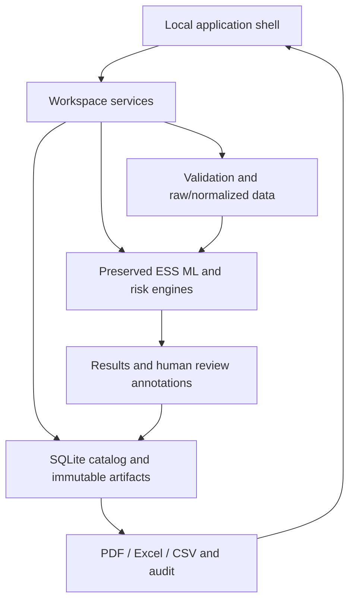

# Architecture

The original `ESS_Sentinel_Complete_Project.zip` was inspected and extracted into an independent review copy before implementation. Its archived SHA-256 is recorded in `docs/original/archive_sha256.txt`. The original ZIP and project were not overwritten.

## Separation of responsibilities

* `ess/`: existing synthetic generation, ingestion, temporal features, peer statistics, regression, Isolation Forest, risk semantics and baseline reporting. Existing public functions remain usable.
* `services/quality.py`: bounded row-level issue details, optional timestamp checks and synthetic timestamp labeling.
* `services/store.py`: SQLite catalog and safe artifact paths. User-supplied batch names are metadata, never filesystem paths. UUID-based IDs name files. Original uploads and normalized CSV are separate.
* `services/workspace.py`: import → validate → persist; train → register; screen → snapshot; scenario → paired baseline/simulation. Business computations stay out of UI pages.
* `services/reports.py`: branded PDFs, vector disposition/trajectory charts, repeated table headers and spreadsheet-safe XLSX.
* `ui/`: theme, common context/cache helpers, navigation and grouped page modules. `app.py` holds only startup, global selection, layout and routing.

## State and consistency

The active batch and active model are persisted settings. A batch-changing operation updates the store and reruns the shell, which initializes the selector before rendering it. This avoids changing an already-created Streamlit widget. Immutable batch/run IDs form cache keys. Registered models are cached by unique ID. Repeated rendering never retrains or re-screens automatically; only first-run demo initialization performs those explicitly logged bootstrap operations.

Results are selected by active batch. If the active model or policy differs from a result's recorded provenance, the UI labels it historical and asks for re-screening. Filtering is retained independently of navigation and keyed by batch. Review state is keyed to run/component so it cannot silently carry into a new assessment.

## Original decision semantics

Median/MAD robust Z, IQR and percentiles are computed within matching lot/family/parameter/unit/temperature/voltage/session cohorts. Too few peers withholds population evidence. Early-feature Isolation Forest is separately trained per parameter. The original risk points, upper/lower safety logic, static-violation overrides, anomaly overrides and incomplete-assessment handling remain unchanged.

The 24h/96h cutoff whitelist and 168h target remain fixed; arbitrary feature selection is deliberately unavailable because it would weaken leakage controls. All values above the cutoff are excluded from predictions. Retrospective future values may be shown in trajectory charts and are labeled accordingly.

## Model experiments

Model Laboratory adds optional seed, candidate selection and bounded tree/stage controls without changing the default estimator choices. Candidates remain linear, two Ridge configurations, Random Forest, and two gradient boosting depths. A linear reference is always retained. Callbacks report completed fits, then calibration/test completion. Model registration is separate from activation. The UI never silently replaces the active model after training.

A corrected reporting edge case now records test metrics when Linear is itself the winning model. This does not change its fitted predictions. The original per-parameter estimator-cloning fix is retained and regression-tested.

## Storage and audit

Catalog schema version 1: batches, models, policies, runs, events, reviews and settings. Files:

* `batches/<id>/original.bin`: exact input bytes.
* `batches/<id>/normalized.csv`: validated mapped data.
* `models/<id>/`: trusted model bundle and manifest, metrics and test predictions.
* `runs/<id>/results.csv`: complete immutable assessment.
* `reports/<id>/report.{pdf,xlsx,csv}`: successfully generated exports.

Model directories are written before catalog registration; failed writes never register a ready model. Atomic writes use temporary files and replacement. SQLite provides transaction boundaries. The UI exposes no deletion or audit editing. Backups use SQLite's backup API plus immutable artifacts; keep the local app idle during backup for a fully quiescent operational snapshot.

## Security and deployment boundary

CSV/XLSX size/content checks, explicit mappings, no user code/model execution, normalized identifiers, path traversal prevention and formula-safe CSV/XLSX. Bundled fonts and local Plotly assets avoid external web fonts/CDNs. Errors record a reference, operation, exception type and bounded message; no environment dump or user dataset payload is logged.

This is local single-user software. Local admins can modify database/model files. No cryptographic audit integrity, authentication, cloud telemetry, protected disposition workflow or concurrency isolation between multiple users is claimed. Run only trusted locally registered joblib artifacts.
