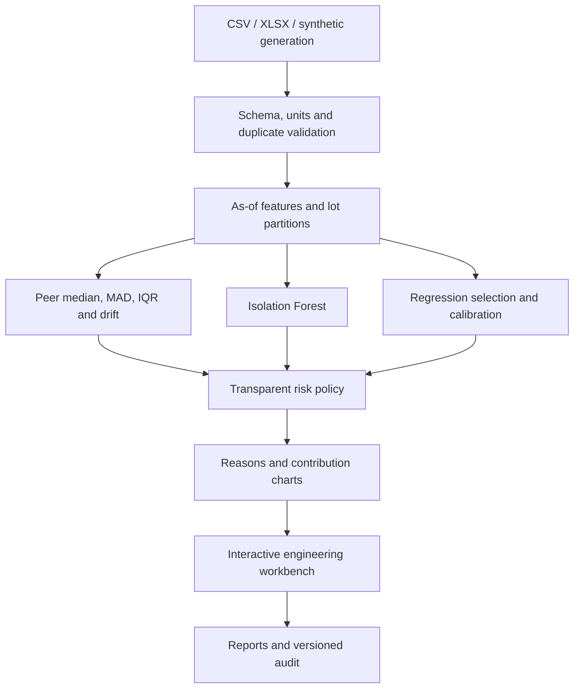

# Architecture and engineering decisions

## Boundary and topology

This is a single-user local application, not a hosted service. Streamlit owns interactive session state. Reusable engines accept/return pandas data frames; training and benchmarks are also available through a CLI. Plotly renders interactive charts. Joblib persists trusted models. SQLite serializes audit writes. ReportLab produces PDFs without external services.

## Training data flow

1. Validate schema, units, numeric values, intervals, identities and duplicate signatures. No silent row deletion.
2. Shuffle unique lots with seed 42. Reserve approximately 20% test, 15% calibration, 15% validation, remainder training. For 20 lots this is 10/3/3/4.
3. Keep all components, parameters and sessions of each lot together. A component spanning lots is rejected.
4. Per parameter, exclude records lacking the required early inputs/target and record the excluded count in the saved artifact. Train numeric imputation/scaling and categorical encoding on training rows only.
5. Fit six candidate estimators, each a separate cloned object. Choose the lowest validation MAE. Do not refit on calibration/test data.
6. Fit Isolation Forest only on training features, without truth labels. A sorted training anomaly-score reference supports inference percentiles.
7. Estimate an absolute residual interval from the separate calibration partition, when at least 20 calibration records are present.
8. Evaluate the selected model and linear baseline on held-out lots. Save all comparisons, prediction errors, feature list, hyperparameters, dataset hash, split IDs, policy and timestamp.

**No future input leakage:** the 24h whitelist contains 0h/24h values, derived early change/slope, temperature, voltage, parameter and family. The optional 96h model adds 96h value, slope and acceleration. Neither whitelist includes 168h measurements, label, defect type, true future value or specification-derived targets. Historical future points can appear in trajectory charts only as explicitly retrospective evidence.

## Population evidence

Peer statistics are contemporaneous, transductive cohort statistics: other components in the screened lot are available at the same stage. This is not an independent per-device prediction benchmark. Comparability requires matching lot, family, parameter, unit, temperature, voltage and measurement session. No fallback mixes unlike conditions. With fewer than the configured minimum peers, population Z evidence is withheld and the result cannot be NORMAL.

Robust Z uses `(x - median) / max(1.4826*MAD, floor_fraction*spec_range)`. The floor prevents division by zero but depends on illustrative engineering policy. Both upward and downward anomalies are assessed. The current peer calculation includes the component itself; very small cohorts and heavily contaminated lots can mask anomalies. Percentiles, IQR and 1st/99th percentiles are available for inspection; robust Z is the default statistical decision rule.

## Risk policy

Points: population up to 30, abnormal drift up to 25, predicted safety crossing 25, proximity up to 10, Isolation Forest up to 10. The GUI exposes all these weights and cutoffs; weights must sum to 100. Default score cutoffs are 20/45/75. The score is **not a probability**.

Explicit overrides:

* Any observed spec breach at/before the screening stage → CRITICAL.
* Population or temporal threshold breach, or predicted safety crossing → at least HIGH RISK.
* Incomplete observations, insufficient peers, unsupported parameter/range, absent prediction, or ML anomaly → at least WATCH.

Upper safety threshold = `spec_min + fraction*(spec_max - spec_min)`. Lower safety threshold is active when `spec_min != 0`, using `spec_min + (1-fraction)*range`. These are configurable demonstration rules, not datasheet qualification advice. Row-specific absolute limits are imported. No system action scraps or releases hardware.

## Reliability and persistence

Ordinary import/model validation errors are shown as actionable UI messages. CSV/XLSX only; 25 MB compressed input and 128 MB expanded XLSX limits. No uploaded code or models execute. Exported CSV strings beginning with spreadsheet formula prefixes are escaped. Imported datasets are retained by hash; trained GUI model versions are retained under `models/history`, with a current alias. The local audit records full policy changes and model/screening provenance.

A batch export is the reproducible record of a particular assessment. Dashboard component totals use worst record status; record-level statistics must not be misread as component failure rates. The local SQLite log is not immutable. Concurrent users, protected disposition, signed artifacts, authentication, backup/retention and access controls require a separate production design.
