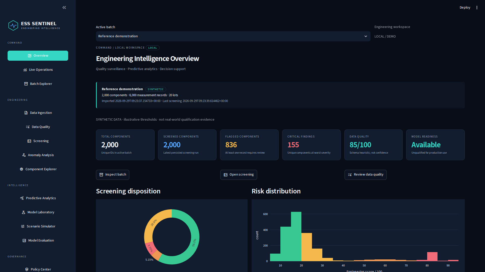
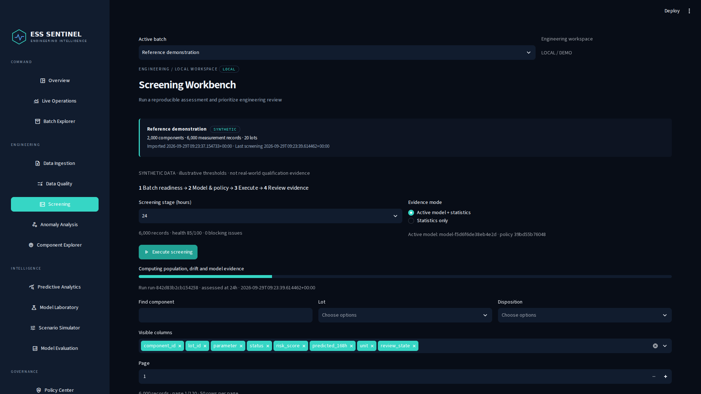
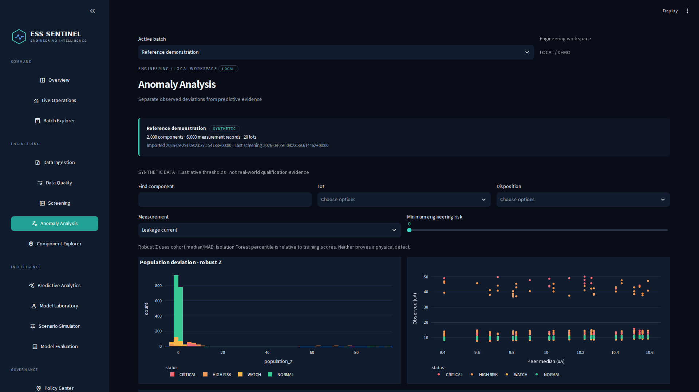
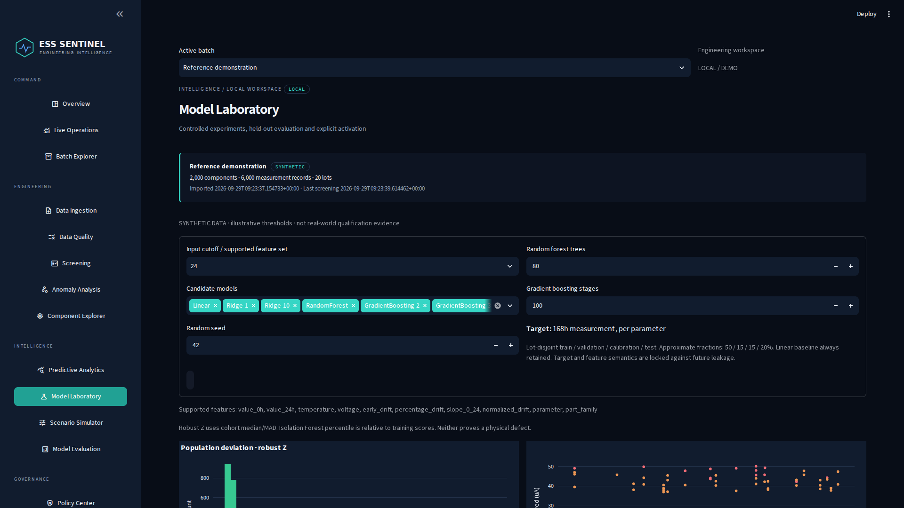
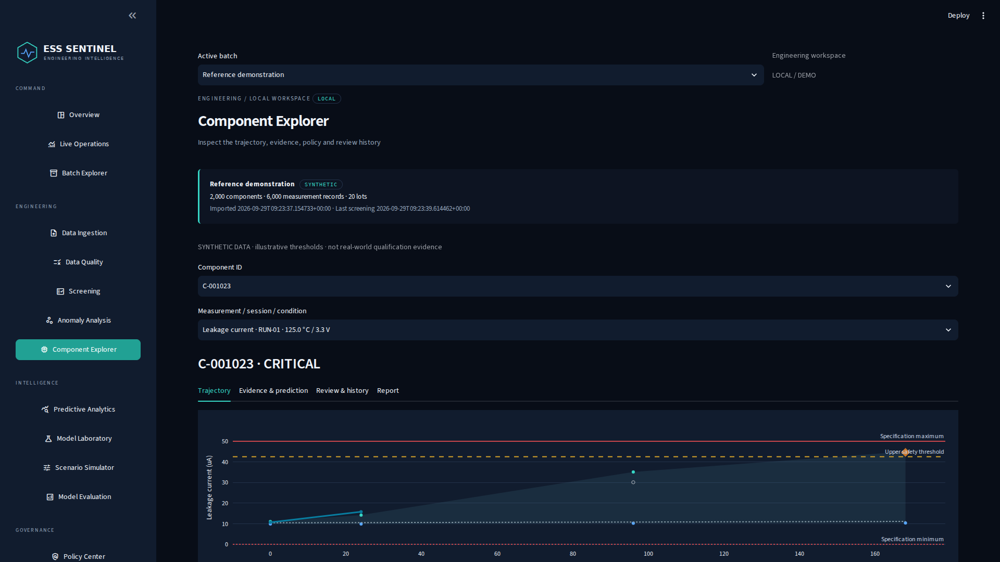
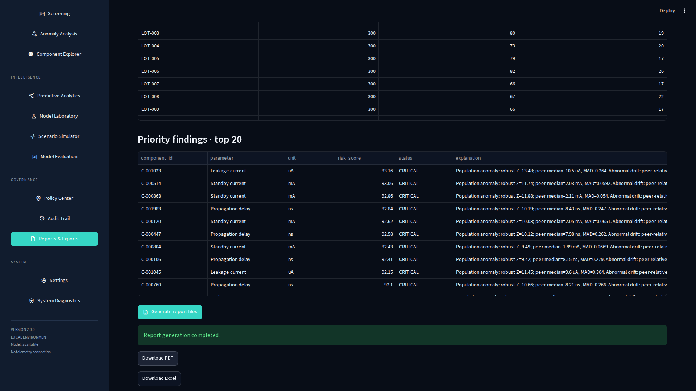
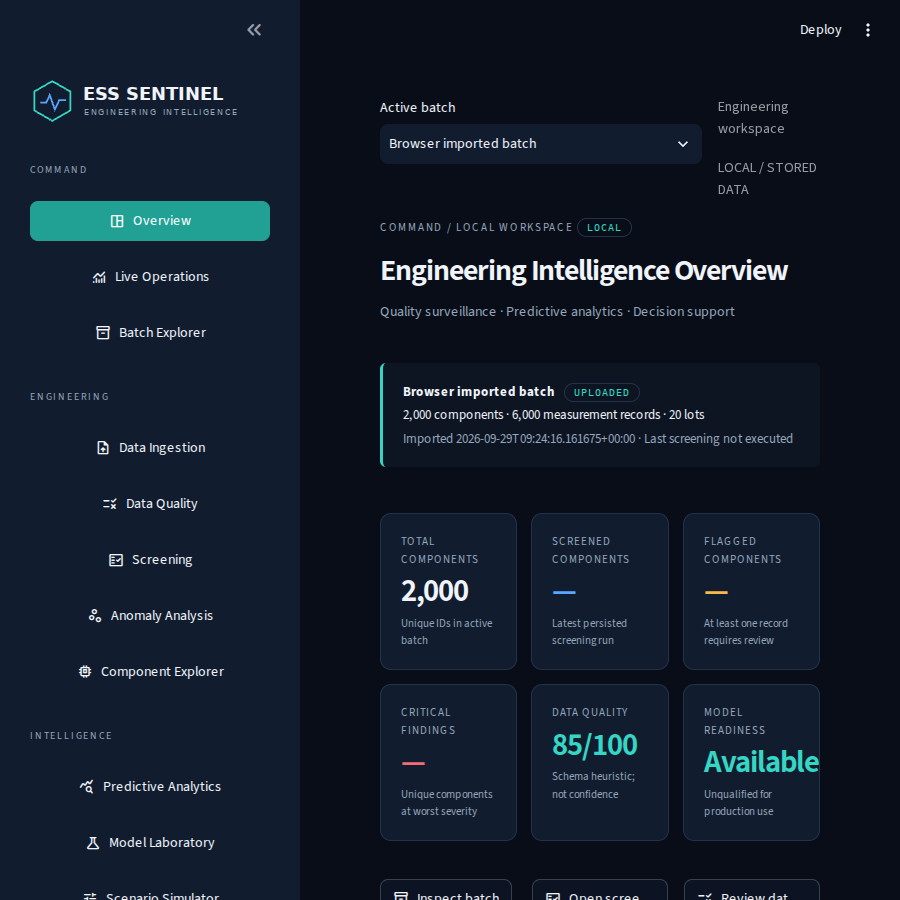

# Genuine browser screenshots

Captured from the running application using Chromium with the application on Python 3.14.6. These are actual UI renders, not mockups. Desktop captures use 1920 × 1080; the narrower layout uses 900 × 900.

